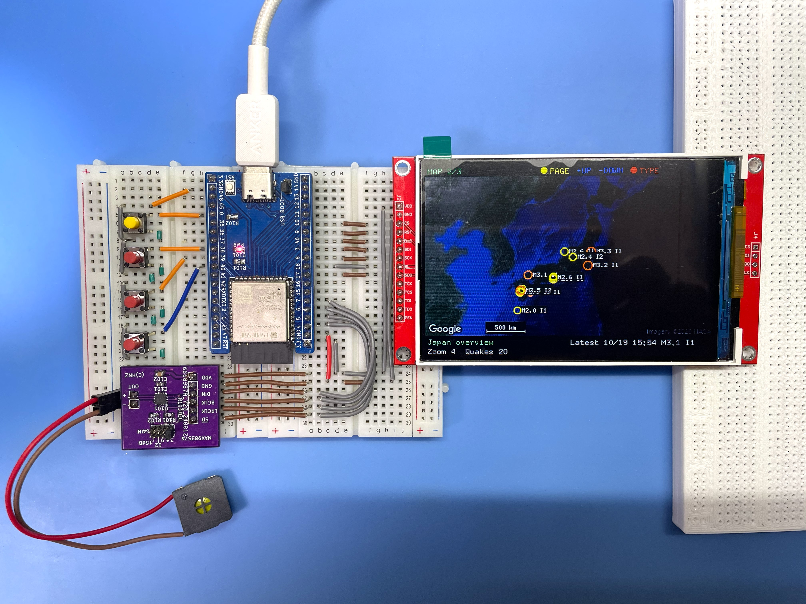
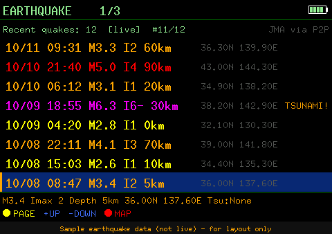
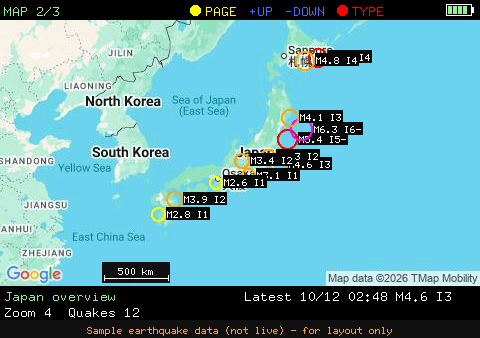
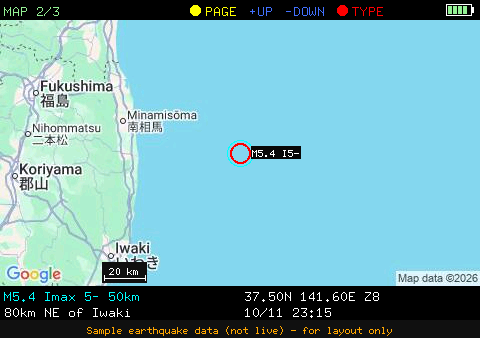
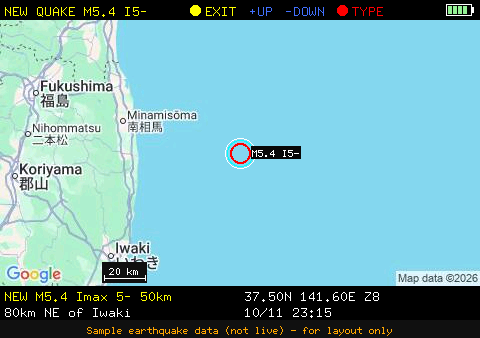
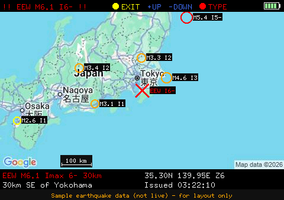
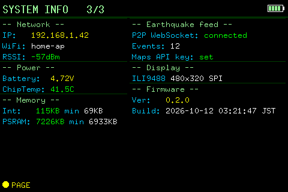
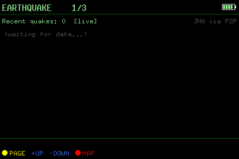
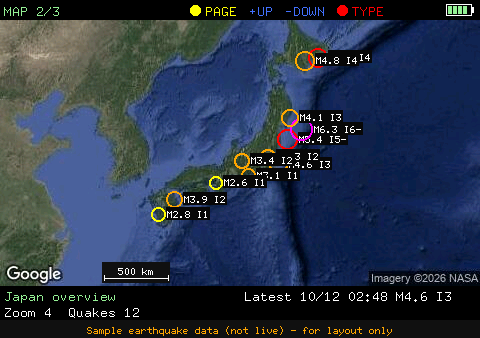

<div align="center">
  <h1><code>EEW Display</code></h1>
</div>



ESP32-S3 firmware for a small earthquake-information display.  It shows recent
earthquakes and emergency earthquake warnings (緊急地震速報, EEW) from
[P2P地震情報](https://www.p2pquake.net/), draws the epicenters on a Google map,
and serves the same data (plus configuration) over Wi-Fi to a browser.  The
display is a 480×320 ILI9488 SPI TFT in landscape orientation; an optional
MAX98357A amplifier speaks EEWs and new earthquakes in Japanese.  Written in Rust
(esp-idf-hal / esp-idf-svc).

> This project grew out of a GNSS satellite viewer.  The GNSS receiver, the SSH
> bridge to it, the eMMC storage (map cache, track log) and the serial terminal
> have been removed; what remains is the earthquake / EEW viewer.  The KiCad
> files in [`hw/`](hw/) and the enclosure in [`STL/`](STL/) still describe the
> earlier GNSS board.

## Features

| Feature | Description |
|---------|-------------|
| Earthquake list | The 20 most recent events (8 rows visible, the list scrolls with the highlight): time (JST), magnitude, maximum intensity, depth, epicenter coordinates and tsunami flag |
| Map | Google Maps Static API tile (satellite or roadmap) filling the screen, with the recent epicenters drawn on it, sized by magnitude and coloured by intensity; Japan overview by default, or centred on the quake picked in the list.  The nearest well-known place, with distance and direction, is shown for the selected / new / EEW epicenter |
| EEW alert | On a warning the TFT switches to the map by itself, marks the forecast epicenter with a red `X` and shows magnitude, maximum forecast intensity and depth; the Web UI shows a red banner |
| Voice (optional) | Chime + Japanese spoken announcement of every EEW and every newly received earthquake through a MAX98357A amplifier; each can be switched off, and the volume set, in the Web UI (see [Spoken announcements](#spoken-announcements-japanese)) |
| Screen saver | The backlight goes off after a configurable idle time and comes back on a button press or an EEW / new earthquake (see [Screen saver](#screen-saver)) |
| Time sync | NTP (up to 4 servers) |
| Web UI | Browser-based configuration, earthquake list, map, audio controls |
| WPS | Wi-Fi Protected Setup (PBC mode), started at boot when no SSID is set |
| Syslog | Optional UDP syslog (RFC 5424) |

---

## Hardware

| Part | Notes |
|------|-------|
| MCU | ESP32-S3 with 16 MB flash and octal PSRAM |
| Display | **ILI9488 480×320** SPI TFT (4-wire SPI, 18-bit colour), landscape.  No touch, no SD slot used |
| Battery | Optional LiPo; voltage is read on GPIO11 (see `adc_conversion_factor`).  Shows `--` / no icon when nothing is connected |
| RTC | 32.768 kHz crystal on GPIO15/16 (falls back to the internal oscillator if absent) |
| Audio (optional) | MAX98357A I2S amplifier (48 kHz, 16-bit stereo; SD_MODE high = on).  See [Spoken announcements](#spoken-announcements-japanese) |
| Buttons | BOOT (GPIO0) plus three user buttons (GPIO38/39/40) |

There is no eMMC and no GNSS receiver on this unit.

### Pin assignment

| Function | GPIO |
|----------|------|
| TFT CS | 10 |
| TFT RST | 9 |
| TFT D/C | 46 |
| TFT SDI (MOSI) | 3 |
| TFT SCK | 8 |
| TFT BL (backlight, active high) | 18 |
| TFT SDO (MISO) | 17 — wired but not used (the panel is write-only here) |
| Battery voltage (ADC) | 11 |
| MAX98357A DIN / BCLK / LRCLK (WS) / SD_MODE | 7 / 6 / 5 / 4 |
| Buttons | 0 (BOOT/Page), 38 (+), 39 (−), 40 (action) — all active-low with internal pull-ups |

The ILI9488 only accepts 18-bit colour over SPI, so the firmware keeps a
RGB565 framebuffer in PSRAM and sends the changed rectangle as 3 bytes per
pixel.  The SPI clock is 27 MHz.  If the picture is mirrored, red/blue are
swapped or the colours look negated on your module, adjust `MADCTL` / `INVERT`
(and `SPI_HZ` if there is noise) at the top of [`src/display.rs`](src/display.rs).

---

## Display Pages

The unit starts on the MAP page; a short press of BOOT cycles the pages.

| # | Page | Content |
|---|------|---------|
| 1 | EARTHQUAKE | Recent earthquakes (list + details of the highlighted one) |
| 2 | MAP | Full-screen Google map (480×266) between a one-line top bar (title, button legend, battery) and a two-column text band: the Japan overview, the quake picked in the list, or the EEW epicenter, with epicenters, scale bar and — for a selected / new / EEW quake — magnitude, intensity, depth, coordinates, nearest place and time |
| 3 | SYSTEM INFO | Network, power, memory, earthquake feed state, display and firmware version |

### Buttons

| Button | EARTHQUAKE page | MAP page | SYSTEM INFO |
|--------|-----------------|----------|-------------|
| BOOT (GPIO0), short | next page | next page (returns the map to the Japan overview) | next page |
| BOOT (GPIO0), ≥ 10 s | factory reset (NVS erased, `cfg.toml` defaults restored) | same | same |
| + (GPIO38) | highlight up | zoom in | zoom in |
| − (GPIO39) | highlight down | zoom out | zoom out |
| Action (GPIO40) | show the highlighted epicenter on the MAP | toggle satellite / roadmap | toggle satellite / roadmap |

While an EEW or a newly received earthquake is shown, BOOT (EXIT) returns to
the normal view.  Buttons auto-repeat after 400 ms.  When the screen is off
(see below) the first press only wakes it — its action is not performed.

### Screen saver

`screen_timeout` (seconds; `0` = the screen stays on) switches the backlight off
after that long without a button press.  It comes back on any button press, an
EEW, a newly received earthquake or a system message (such as the factory-reset
countdown).  While it is off nothing is sent to the panel, and the picture is
brought up to date in one go on wake-up.  Set it in `cfg.toml` or under
*Display* in the Web UI (applies immediately).  Spoken announcements are
independent of the screen.

### TFT screenshots

Rendered by [`tools/screenshots`](tools/screenshots) from the firmware's own
drawing code.  **The earthquake data is synthetic sample data (made-up events,
not live)** — the pages that show it carry a caption saying so.  The map is a
real Google Maps tile when the tool is given a key (see below), else a schematic
stand-in.

| | | |
|---|---|---|
| <br>**EARTHQUAKE** | <br>**MAP** (overview) | <br>**MAP** (quake picked from the list) |
| <br>**MAP** (new earthquake) | <br>**MAP** (EEW) | <br>**SYSTEM INFO** |
| <br>**EARTHQUAKE** (waiting for data) | <br>System message overlay | <br>**MAP** (satellite) |

---

## Earthquakes and EEW (P2P地震情報)

With `quake_enable = "true"` in `cfg.toml` (the default) the unit shows recent
earthquakes and emergency earthquake warnings (緊急地震速報, EEW) from
[P2P地震情報](https://www.p2pquake.net/) (JSON API v2).  The data is
originally issued by the Japan Meteorological Agency (気象庁).  It needs Wi-Fi
and a synced clock (NTP), because the connection is TLS.

| Where | What you get |
|-------|--------------|
| **EARTHQUAKE** page (TFT) | The 20 most recent events (8 rows visible, the list scrolls with the highlight): time (JST), magnitude, maximum intensity (`I5-` = 5弱, `I5+` = 5強, …), depth and epicenter coordinates; tsunami warnings are flagged.  **+ / −** move the highlight, the **action** button (GPIO40) shows the highlighted epicenter on the MAP page |
| **MAP** page | Epicenters of recent earthquakes inside the visible map are drawn as circles — sized by magnitude, coloured by maximum intensity — with a label such as `M5.2 I5-` |
| **Web UI** (configuration page) | A *Recent Earthquakes* card with the epicenter name (Japanese), magnitude, intensity, depth and tsunami status.  The epicenter name opens the Web UI map (`/map?lat=…&lon=…&zoom=…`) centred on it |
| **EEW alert** | On a warning the TFT switches to the MAP page by itself and centres the forecast epicenter: a large red `X`, the header turns red (`!! EEW M6.3 I5- !!`) and a box at the bottom right of the map shows magnitude, maximum forecast intensity, depth, coordinates and issue time.  The Web UI shows a red banner with the forecast areas |

The TFT font is ASCII only, so Japanese epicenter and area names appear in the
Web UI only; the TFT shows the coordinates and, on the MAP page, the nearest
well-known place with distance and direction (e.g. `45km ESE of Iwaki`, from a
built-in table of ~100 cities and islands in [`src/place.rs`](src/place.rs), so it
works offline and for epicenters at sea).  The unit has no position sensor, so
it does not compute the distance to the epicenter.

How it works (`src/quake.rs`):

- A WebSocket (`wss://api.p2pquake.net/v2/ws`) receives the events as they are
  registered.  Warnings (code 556) raise the alert, earthquake reports (551) are
  merged into the list.  Test messages and warnings older than 3 minutes (by
  their issue time) are ignored, so a boot in the middle of an old event does
  not alert.
- REST (`/v2/history`) loads the initial list (the 20 latest events) at boot,
  re-syncs it every 30 minutes, and takes over — polling every 10 s (EEW) /
  60 s (list) — while the WebSocket is down.
- The WebSocket pings every 30 s and reconnects by itself 30 s after a drop
  (the server also closes long-lived connections now and then, e.g. after about
  an hour); it is only recreated after it has stayed down for 180 s.
- Network use waits for an IP address: the map and the feed start as soon as
  Wi-Fi reports one (tracked from system events, not by polling the driver).
- **Memory:** the TLS WebSocket holds roughly 30 KB of internal RAM, which
  competes with the map tile download.  The WebSocket is therefore dropped for
  the duration of every map fetch and re-created once the map has been idle for
  about 12 s; any warning issued in the gap is recovered by a REST check right
  after it reconnects.  REST polling is skipped while internal RAM is low or a
  map fetch is running.  Watch *Free Heap (Internal)* in the Web UI and
  `[HEAP]` / `[WS]` / `[QUAKE]` in the log.
- The WebSocket needs the `esp_websocket_client` ESP-IDF component, pulled from
  the component registry at build time (declared in `Cargo.toml`), so the first
  build needs network access.

**Testing without a real earthquake.**  Build with the sandbox feature:

```bash
cargo build --release --features quake-sandbox
```

This points the feed at the P2P sandbox, which replays old data (including a
2023 Hokkaido EEW) and skips the "older than 3 minutes" check, so the whole
alert path fires right after boot.  Never ship a sandbox build.

> **Not a safety device.**  Delivery is not guaranteed and can be delayed; the
> warning only covers what the Meteorological Agency issues as a warning.  Do
> not rely on this unit for life-safety decisions.  Use the official channels.
> Use of the data is subject to the P2P地震情報
> [terms for secondary use](https://www.p2pquake.net/secondary_use/): credit the
> Japan Meteorological Agency and P2P地震情報 (the Web UI card already does).

---

## Spoken announcements (Japanese)

With a MAX98357A fitted (`audio_enable = "true"`) the unit speaks:

- **EEW**: a 1.5 s arpeggio chime (seven notes with harmonics, about 20
  frequency components; the pitch steps up at 0.4 s), then
  「緊急地震速報。震源は福島県沖です。マグニチュード6点1。最大震度6弱と予測されます。強い揺れに警戒してください。」
  The chime + sentence is played twice (`EEW_REPEATS` in `src/voice.rs`).  Played
  for the first report of an event, and for later reports only when the forecast
  maximum intensity rises.  It interrupts anything else.
- **New earthquake** (pushed over the WebSocket, not the list loaded at boot): a
  "ピンポン" chime, then the sentence once:
  「地震情報。震源は茨城県南部です。マグニチュード4点6。最大震度4。深さ50キロ。この地震による津波の心配はありません。」
  Dropped if an EEW is being spoken.

The chimes are generated by the firmware — sustained / bell-like notes with a
reverb that is applied to the chime only, not to the speech — so they also sound
without a voice bank.  The audio thread runs at a raised priority on core 1 with a
~60 ms I2S DMA buffer, so that the TLS / JPEG work of a simultaneous map refetch
cannot make the sound break up.
The speech is **not synthesized on the device and needs no network or API key at
run time**.  It is generated once on a PC with Google Cloud Text-to-Speech as
~340 short parts (fixed phrases, numbers 0–99 and 100–700, the nine seismic
intensities, and parts of region names such as 福島県 + 沖) and flashed to a
dedicated `voice` partition; the firmware strings the parts together.  A
hypocenter name is spoken as far as its parts match (so 福島県沖 = 福島県 + 沖); a
name with an unknown part is cut short instead of being misread.  To cover more
names, add parts to [`tools/voice/tokens.txt`](tools/voice/tokens.txt) and
regenerate.

### 1. Generate `voice.bin` (once, on a PC)

Enable the **Cloud Text-to-Speech API** in the Google Cloud project (and allow it
on the API key if the key has API restrictions), then:

```bash
cd tools/voice
GOOGLE_TTS_API_KEY=your-key python3 gen_voice.py            # default voice ja-JP-Neural2-B
# python3 gen_voice.py --voice ja-JP-Neural2-C --rate 1.05   # other voice / speed
```

Each part is synthesized once and cached in `tools/voice/cache/`, so re-running
costs no API calls unless a part changed (~340 short requests, within the free
tier).  `python3 gen_voice.py --dry-run` makes a `voice.bin` of tone bursts with
no API call — only to test the flashing and playback path.  Check the Google
Cloud TTS terms and pricing for your use; the generated audio is yours to flash
into your own device.

### 2. Flash

The `voice` partition (9 MB at `0x700000`) is part of `partitions.csv`, so the
firmware has to be flashed once to write the new partition table, then the voice
bank.  [`flash.sh`](flash.sh) does both, then opens the monitor:

```bash
./flash.sh                  # firmware + partition table, voice bank, monitor
./flash.sh --voice-only     # only the voice bank (after regenerating voice.bin)
./flash.sh --no-voice       # firmware only
./flash.sh --port /dev/ttyACM1 --no-monitor
```

By hand: `cargo espflash flash --release`, then
`cargo espflash write-bin 0x700000 tools/voice/voice.bin`.

A hand-built merged image (`cargo espflash save-image --merge complete_flash.bin`)
does not contain the voice bank; flash `voice.bin` separately as above.
`build-flash-images.sh`, however, folds `voice.bin` into its output when it is
present (see [Build](#creating-a-complete-flash-binary-image)), so that one file
carries it.  The boot log shows `[VOICE] bank loaded: N parts` (or why
announcements are off).

### 3. Test

The Web UI configuration page has an **Audio** card (shown when `audio_enable =
"true"`): *Test EEW voice* and *Test new-quake voice* play sample announcements
(also when the matching switch is off), and the sine test tone (100 Hz – 15 kHz,
off by default) can be switched on and tuned.  The same card has the **volume**
slider (applied while you drag, stored in NVS on release) and the **Announce**
switches: EEW and new-earthquake announcements (chime + speech) can each be
turned on or off (both on by default; stored in NVS and overriding
`voice_eew` / `voice_new` in `cfg.toml`).

---

## Architecture

```
p2pquake.net ◄── quake.rs (WebSocket: EEW + events, REST fallback)
                    │
                    ├── display.rs ── ILI9488 driver + RGB565 framebuffer, screen saver
                    │      └── display_pages.rs (EARTHQUAKE / MAP / SYSTEM INFO drawing)
                    │             └── place.rs (epicenter → nearest place text)
                    ├── map_display.rs ── persistent fetch worker ──► Google Static Maps (HTTPS)
                    ├── voice.rs ── sentences from the `voice` flash partition
                    │      └── audio.rs ── I2S → MAX98357A (chimes, ADPCM speech, test tone)
                    └── httpserver.rs ── Web UI: config, quake list, map, audio
btn_ctrl.rs (buttons) · wifi.rs (STA, WPS, reconnect, network state) · boot_log.rs
```

---

## Directory Layout

```
eew-display/
├── src/
│   ├── main.rs           # Entry point, peripheral initialisation
│   ├── display.rs        # ILI9488 SPI driver, framebuffer, display task, screen saver
│   ├── display_pages.rs  # Page drawing (earthquake, map, info); no ESP-IDF dependency
│   ├── map_display.rs    # Map tile fetch, JPEG decode, zoom
│   ├── audio.rs          # MAX98357A I2S output: voice playback (ADPCM) + test tone
│   ├── voice.rs          # Spoken-announcement sentences from the `voice` partition
│   ├── place.rs          # Epicenter → nearest place text (offline table)
│   ├── quake.rs          # Earthquake list + EEW (P2P地震情報 WebSocket / REST)
│   ├── httpserver.rs     # HTTP server, NVS config management
│   ├── wifi.rs           # Wi-Fi STA connection (DHCP / static IP), WPS, reconnect, event-driven network state
│   ├── syslogger.rs      # UDP Syslog logger (RFC 5424)
│   ├── btn_ctrl.rs       # Button handling
│   └── boot_log.rs       # NVS boot counter and rolling reset-reason log (last 10 entries)
├── tools/
│   ├── voice/            # PC tool: generates voice.bin (Google Cloud TTS) — see Spoken announcements
│   └── screenshots/      # Host tool: renders every TFT page to PNG (see below)
├── docs/images/          # README images; tft/ holds the generated TFT screenshots
├── hw/                   # KiCad schematic/PCB of the earlier GNSS board
├── STL/                  # Enclosure of the earlier GNSS board
├── cfg.toml              # Build-time default configuration (gitignored — contains credentials)
├── cfg.toml.tmp          # Template for cfg.toml (safe to commit)
├── espflash.toml         # espflash settings (16 MB flash, partition table)
├── sdkconfig.defaults    # ESP-IDF build settings
├── partitions.csv        # Flash partition table
├── flash.sh              # Flash firmware + partition table + voice bank, then monitor
├── setup_env.sh          # One-shot environment setup (Rust, espup, udev)
└── build-flash-images.sh # Build a merged flash image from the cfg.toml.tmp defaults
```

---

## Configuration

### cfg.toml (build-time defaults)

`cfg.toml.tmp` is the only template.  Before building, copy it to `cfg.toml`
(which is not committed, since it holds your Wi-Fi credentials and API key):

```bash
cp cfg.toml.tmp cfg.toml
```

Then edit `cfg.toml` for your environment.  The table name must match the crate
name, `[eew-display]`, or the values are ignored.  An older `cfg.toml` from the
GNSS version needs updating: `ssh_user` / `ssh_password` are now `web_user` /
`web_password`, and `com1_*`, `display_port` and `emmc_enable` are gone.

Every key is optional; a missing key uses the built-in default below.  The
shipped `cfg.toml.tmp` template already sets `screen_timeout = "300"` and
`audio_enable = "true"`.

| Setting | Built-in default | Change it when |
|---------|---------|----------------|
| `display_enable` | `"true"` | There is no TFT |
| `screen_timeout` | `"0"` | You want the backlight off after N idle seconds (`0` = never); also in the Web UI |
| `quake_enable` | `"true"` | You want to turn the earthquake / EEW feed off.  The feed keeps a TLS WebSocket open (~30 KB of internal RAM) and needs Wi-Fi plus a synced clock.  Read at boot only, so rebuild after changing it |
| `audio_enable` | `"false"` | A MAX98357A is fitted: `"true"` starts the audio output (voice announcements + Web UI test tone) |
| `audio_volume` / `voice_eew` / `voice_new` | `"70"` / `"true"` / `"true"` | Voice volume in percent, and whether EEWs / new earthquakes are announced.  The Web UI overrides these (stored in NVS) |
| `adc_conversion_factor` | `"80.098"` (template: `"437.98"`) | The battery voltage divider differs: voltage = raw ADC reading ÷ this factor |
| `web_user` / `web_password` | `admin` / `esp32` | Always — these protect the Web UI |
| `maps_api_key` | empty | You want the map (see [Google Maps API key](#google-maps-api-key)) |

```toml
[eew-display]
wps_enable     = "true"     # "true": use WPS PBC on next boot when SSID is empty
wifi_ssid      = ""         # your-ssid
wifi_psk       = ""         # your-password
ip_mode        = "dhcp"           # "dhcp" or "static"
ip_address     = "192.168.0.200"
subnet_mask    = "255.255.255.0"
gateway        = "192.168.0.1"
dns            = "1.1.1.1"

syslog_server    = "192.168.0.140:514"
syslog_enable    = "false"
syslog_host_name = "esp32s3"
syslog_app_name  = "eew-display"

web_user     = "admin"
web_password = "esp32"

display_enable = "true"
screen_timeout = "300"     # backlight off after this many idle seconds (0 = always on)

ntp_server1 = "time.aws.com"
ntp_server2 = "time.google.com"
ntp_server3 = "time.cloudflare.com"
ntp_server4 = "ntp.nict.jp"

adc_conversion_factor = "437.98"

quake_enable         = "true"

audio_enable         = "true"    # MAX98357A: voice announcements + Web UI test tone
audio_volume         = "70"      # voice volume, percent (0-100)
voice_eew            = "true"    # announce EEWs (chime + speech)
voice_new            = "true"    # announce new earthquakes (chime + speech)

maps_api_key = ""
```

Values in `cfg.toml` are compiled into the firmware as defaults.
After boot they can be overridden via the Web UI or direct NVS writes; NVS values take priority.
A factory reset (hold BOOT ≥ 10 s, or *Reset Defaults* in the Web UI) erases NVS and
returns to the `cfg.toml` values.

The Web UI configuration page has these cards: *Device Status*, *Recent
Earthquakes*, *Audio*, *WiFi* (SSID, password, WPS), *Network* (DHCP / static
IP), *Syslog*, *Authentication*, *Display* (screen timeout), *NTP Servers* and
*Map Settings* (map type, Maps API key), plus *Boot Log*, *Reboot* and *Reset
Defaults*.

### Google Maps API key

The map pages (LCD and Web UI) download images from the **Maps Static API**, so
they need a Google Maps Platform API key.  Without `maps_api_key` the MAP page
has nothing to draw the epicenters on (there is no local tile cache), although
the EARTHQUAKE list and EEW alerts keep working.

**Where to get one**

1. Sign in to the [Google Cloud console](https://console.cloud.google.com/) and
   create (or select) a project.
2. Link a **billing account** to the project.  Maps Platform APIs require one,
   even though usage within the free monthly allowance is not charged — see the
   [Google Maps Platform pricing](https://mapsplatform.google.com/pricing/) page
   for the current allowance.
3. Open **APIs & Services → Library**, search for **Maps Static API** and click
   **Enable**.
4. Open **APIs & Services → Credentials**, click **Create credentials → API key**
   and copy the key.  Step-by-step instructions are in Google's
   [Maps Static API documentation](https://developers.google.com/maps/documentation/maps-static/get-api-key).
5. Enter the key in the Web UI: **Config page → Map Settings → Google Maps API
   Key**, then **Save**.  It takes effect immediately (no reboot) and is stored
   in NVS.  To have a key built in as the default instead (for a fresh or
   factory-reset device), set it in `cfg.toml` and rebuild:

   ```toml
   maps_api_key = "your-api-key"
   ```

**Notes**

- The key is stored in NVS and can be changed from the Web UI at any time.
  `maps_api_key` in `cfg.toml` is only the default, used until a key is saved
  and restored by a factory reset (saving an empty field also falls back to it).
- The Web UI map pages load images directly from Google in your browser, so the
  device hands the key to any logged-in browser (`/api/mapkey`).  Keep the
  device login password strong, and do not share firmware images built with your
  own key (`build-flash-images.sh` builds from `cfg.toml.tmp`, whose key is empty).
- In the Cloud console, restrict the key under **API restrictions** to the
  **Maps Static API** only, and set a budget alert or quota so a leaked key cannot
  run up a bill.  An application restriction (HTTP referrer / IP) is awkward here
  because requests come both from the device and from browsers on your LAN.
- `cfg.toml` is not committed.  Never put a real key in `cfg.toml.tmp`, which is
  the template that gets committed.  Because the Web UI can set the key, you can
  leave `cfg.toml` empty and keep the key out of the build entirely.

---

## Wi-Fi Setup with WPS

**WPS (Wi-Fi Protected Setup)** allows you to connect to a Wi-Fi network without manually entering the SSID and password. This device supports **WPS Push Button Configuration (PBC)** mode.

WPS runs **at boot, when `wps_enable = "true"` and no SSID is stored**; there is no
"Start WPS" button in the Web UI (the *WiFi* card only has the *WPS* Enable /
Disable switch and the SSID / password fields).

### Method 1: Using cfg.toml (initial setup)

1. **Edit `cfg.toml` before building**:
   ```toml
   wifi_ssid      = ""           # empty: no credentials
   wps_enable     = "true"       # use WPS when there is no SSID
   ```
2. **Flash the firmware** to the device.
3. On boot the screen shows *WPS MODE*: **press the WPS button on your Wi-Fi
   router within 120 seconds**.
4. On success the credentials are saved to NVS and the unit carries on connecting
   (no reboot needed).  They persist across reboots.

### Method 2: Switch an already configured unit to WPS

- Perform a **factory reset** (hold the BOOT button, GPIO0, for **≥ 10 s**): NVS is
  erased, the `cfg.toml` defaults are restored (so an empty `wifi_ssid` with
  `wps_enable = "true"` in `cfg.toml` gives WPS again) and the unit reboots.
- Or, in the Web UI, clear the SSID, set *WPS* to *Enable*, **Save** and reboot.

### If WPS fails

If no WPS handshake succeeds within 120 s the unit stays **without Wi-Fi until the
next boot** (and therefore without the Web UI, the map and the earthquake feed).
Reboot to try again, or enter the credentials in `cfg.toml` / the Web UI.

### Wi-Fi reconnection

A background monitor checks every 30 s (after a 15 s grace period) and calls
`esp_wifi_connect()` when the station is not associated; after three failures in a
row it also restarts the Wi-Fi driver.  The router being unreachable makes the
driver log `Haven't to connect to a suitable AP now!` — that is the driver
retrying, not an error of this firmware.

### Notes

- WPS PBC mode is the only supported WPS method (PIN mode is not supported).
- You can always set the credentials in `cfg.toml` or the Web UI instead.

---

## Environment Setup

Run `setup_env.sh` **once** on a fresh Ubuntu / Debian machine (or WSL2) before
building.  The script performs all steps below automatically.

```bash
bash setup_env.sh
```

After the script finishes, open a new terminal (or reload your shell config) so
the environment variables take effect:

```bash
source "$HOME/.cargo/env"
source ~/export-esp.sh
```

### What the script does

| Step | Action |
|------|--------|
| 1 | Install system packages via `apt` |
| 2 | Install Rust toolchain via `rustup` (skipped if already present) |
| 3 | Install `ldproxy`, `espup`, `cargo-espflash` via Cargo |
| 4 | Install & update the ESP32-S3 Xtensa toolchain via `espup` |
| 5 | Source `~/export-esp.sh` (generated by `espup`) |
| 6 | Add udev rule for ESP32 USB device (`303a:1001`) and reload rules |

> If you prefer to run the steps manually, expand the section below.

<details>
<summary>Manual setup steps</summary>

```bash
# 1. System packages
sudo apt update && sudo apt -y install \
    git python3 python3-pip gcc build-essential curl \
    pkg-config libudev-dev libtinfo5 clang libclang-dev \
    llvm-dev udev libssl-dev python3.10-venv

# 2. Rust
curl --proto '=https' --tlsv1.2 -sSf https://sh.rustup.rs | sh
# Select option 1 (default install), then:
source "$HOME/.cargo/env"

# 3. Cargo tools
cargo install ldproxy
cargo install espup
cargo install cargo-espflash

# 4. ESP32-S3 toolchain
espup install
espup update

# 5. Activate ESP environment (add to ~/.bashrc / ~/.zshrc for persistence)
. ~/export-esp.sh

# 6. udev rules
sudo sh -c 'echo "SUBSYSTEMS==\"usb\", ATTRS{idVendor}==\"303a\", ATTRS{idProduct}==\"1001\", MODE=\"0666\"" > /etc/udev/rules.d/99-esp32.rules'
sudo udevadm control --reload-rules
sudo udevadm trigger
```

</details>

---


## Build and Flash

### Prerequisites

- Rust toolchain: `esp` channel (selected automatically via `rust-toolchain.toml`)
- [espup](https://github.com/esp-rs/espup) — ESP32-S3 Xtensa toolchain
- [espflash](https://github.com/esp-rs/espflash)
- ESP-IDF v5.4.2 (fetched automatically by the build)
- Python 3 (standard library only) for `tools/voice/gen_voice.py`

### Build

```bash
cp cfg.toml.tmp cfg.toml    # then edit it
cargo build --release
```

The first build downloads the `esp_websocket_client` component (used by the
[earthquake feed](#earthquakes-and-eew-p2p地震情報)), so it needs network access.
Add `--features quake-sandbox` to test that feed against the P2P sandbox.

### Flash and monitor

```bash
./flash.sh                              # firmware + partition table + voice bank, then the monitor
cargo espflash flash --release --monitor   # firmware + partition table only
```

[`flash.sh`](flash.sh) also writes `tools/voice/voice.bin` to the `voice`
partition (see [Spoken announcements](#2-flash)).  The first flash after
pulling the voice feature must include the partition table, as both commands do.

### Creating a complete flash binary image

To create a single binary file with the bootloader, partition table and application (no voice bank) for distribution or web-based flashing:

```bash
cargo espflash save-image --release --merge --chip esp32s3 complete_flash.bin
```

To build a merged image from the `cfg.toml.tmp` defaults in one go (Wi-Fi and
API key unset, for distribution), run `build-flash-images.sh`.  The 16 MB image
is written to `flash_images/flash_eew-display.bin`; flash it alone to **0x0**.
When `tools/voice/voice.bin` exists it is folded into the image at the `voice`
partition offset (0x700000), so the one file also carries the spoken
announcements — otherwise the image is built without them and the script says so.
Your own `cfg.toml` is restored afterwards.

**Important**: When flashing a merged image, always write it to **offset 0x0**, not 0x9000. Writing to 0x9000 will result in a boot failure with "invalid header: 0xffffffff" error.

#### Flash the complete binary

```bash
# Using esptool.py
esptool.py --chip esp32s3 --port /dev/ttyACM0 write_flash 0x0 complete_flash.bin

# Using espflash
espflash write-bin 0x0 complete_flash.bin
```

#### Web-based flashing (no command line required)

You can also flash the binary via a web browser using the ESP Web Flasher:

1. Open [https://thelastoutpostworkshop.github.io/ESPConnect/](https://thelastoutpostworkshop.github.io/ESPConnect/) in Chrome, Edge, or Opera (Web Serial API required)
2. Click **"Connect"** and select your ESP32-S3 device from the serial port list
3. Click **"Choose File"** and select `complete_flash.bin`
4. Set the flash address to **`0x0`** (very important!)
5. Click **"Program"** to start flashing
6. Wait for the process to complete and click **"Reset Device"**

### Flash layout

| Partition     | Offset   | Size                |
|---------------|----------|---------------------|
| nvs           | 0x9000   | 24 KB               |
| phy_init      | 0xF000   | 4 KB                |
| factory (app) | 0x10000  | 0x6F0000 (7104 KB)  |
| voice (data)  | 0x700000 | 0x900000 (9 MB)     |

Flash: 16 MB, DIO mode, 40 MHz.  The `voice` partition holds `tools/voice/voice.bin`
(~2.4 MB); see [Spoken announcements](#spoken-announcements-japanese).

### Regenerating the TFT screenshots

`tools/screenshots` is a small host-side crate (separate from the firmware, built
with the stable toolchain for your PC) that compiles the firmware's own
`src/display_pages.rs` and renders each page into a 480×320 framebuffer, then
writes PNGs.  Quake and map data are replaced by stubs filled with sample data
(pages that show it get a "sample data" caption band under the image).

```bash
cd tools/screenshots
cargo run --release -- [OUT_DIR] [SCALE]    # default: ../../docs/images/tft, 1
```

Map pages fetch real tiles with the same Static Maps request the firmware uses.
The key is taken from the `GOOGLE_MAPS_API_KEY` environment variable, else
`maps_api_key` in `cfg.toml`; tiles are cached in `tools/screenshots/.tile-cache/`
(gitignored).  Without a key — or with `SCREENSHOTS_OFFLINE=1` — a schematic map
is drawn instead.  The firmware version on the SYSTEM INFO sample is read from
`Cargo.toml`.

---

## Web UI Endpoints

Once the device is on Wi-Fi, the Web UI is at `http://<device_ip>/` (login
required: `web_user` / `web_password`).

| URL | Method | Description |
|-----|--------|-------------|
| `/login` | GET / POST | Login |
| `/logout` | GET | Logout |
| `/` | GET | Configuration page, device status and recent earthquakes (auth required) |
| `/map` | GET | Map page with the recent epicenters; `?lat=&lon=&zoom=` views an arbitrary point (e.g. an epicenter) |
| `/api/mapinfo` | GET | Map centre and zoom the TFT is showing (JSON) |
| `/api/quakes` | GET | Recent earthquakes and the active EEW, if any (JSON; `enabled:false` when `quake_enable` is off) |
| `/api/map/pixels` | GET | Current map image (raw RGB565) |
| `/api/mapkey` | GET | Maps API key and map type, for the browser-side map |
| `/api/map/zoomin`, `/api/map/zoomout` | POST | Change map zoom |
| `/api/map/toggletype` | POST | Toggle satellite / roadmap |
| `/api/config` | POST | Save configuration to NVS |
| `/api/status` | GET | Device / Wi-Fi status, heap, firmware version and build date (JSON) |
| `/api/reset` | POST | Erase NVS and restore cfg.toml defaults |
| `/api/reboot` | POST | Reboot the device |
| `/api/boot_log` | GET | Boot history with reset reasons from NVS (JSON) |
| `/api/tone` | GET / POST | Audio state (running, tone Hz / on, voice bank present, volume, announcement switches).  POST any of: `hz=100..15000`, `on=true|false` (test tone); `speak=eew|new` (play a sample announcement); `volume=0..100` (`&save=1` also stores it in NVS); `notify_eew=true|false`, `notify_new=true|false` (stored in NVS).  Only with `audio_enable = "true"` |

---

## Dependencies

| Component / Library | Version | License | Purpose |
|---------------------|---------|---------|---------|
| **eew-display** (this project) | 0.2.0 | MIT | Firmware (Rust) |
| esp-idf-hal | 0.45.2 | MIT / Apache-2.0 | ESP32-S3 hardware abstraction (SPI, I2S, GPIO, ADC) |
| esp-idf-svc | 0.51 | MIT / Apache-2.0 | Wi-Fi, HTTP server/client, WebSocket, SNTP, etc. |
| esp-idf-sys / ESP-IDF | 0.36 / v5.4.2 | MIT / Apache-2.0 | Bindings and SDK |
| espressif/esp_websocket_client | ^1.4 | Apache-2.0 | WebSocket client (component registry, fetched at build time) |
| embedded-svc | 0.28 | MIT / Apache-2.0 | HTTP / WebSocket traits |
| jpeg-decoder | 0.3 | MIT / Apache-2.0 | Map tile decoding |
| embedded-graphics | 0.8.1 | MIT / Apache-2.0 | Display rendering (the ILI9488 driver is in `src/display.rs`) |
| serde / serde_json | 1 | MIT / Apache-2.0 | P2P地震情報 JSON |
| chrono | 0.4 | MIT / Apache-2.0 | Date and time |
| toml-cfg, heapless, anyhow, log | — | MIT / Apache-2.0 | Build-time config, buffers, errors, logging |

Map imagery is provided by the Google Maps Static API, earthquake / EEW data by
P2P地震情報 (originally Japan Meteorological Agency data) and the spoken parts
are synthesized with Google Cloud Text-to-Speech (on a PC, once); all are subject
to their own terms of use.
